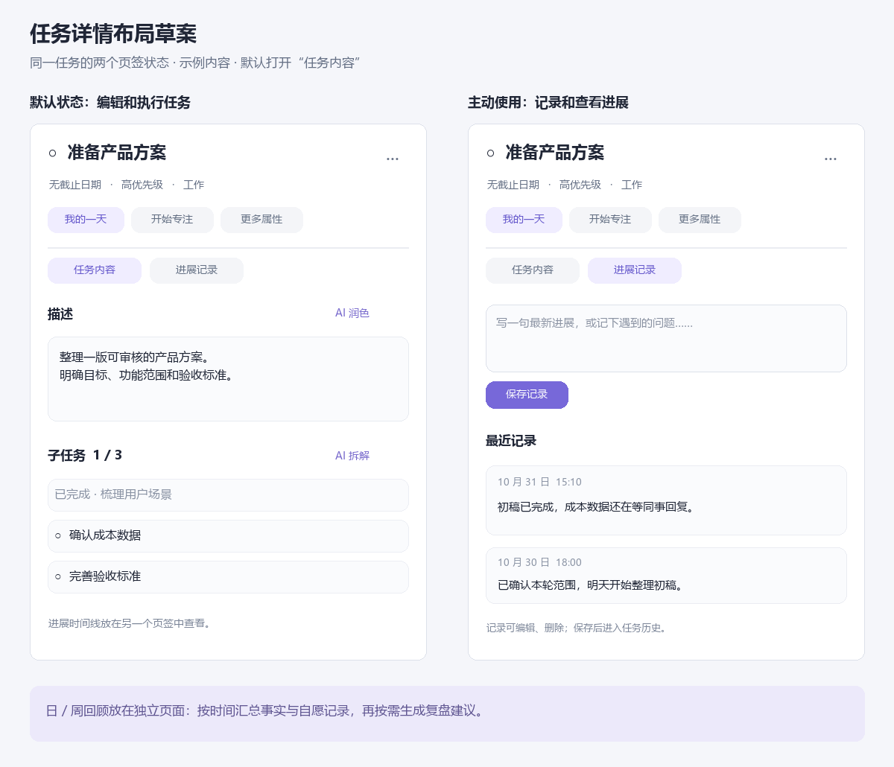

# TodoFlow 任务进展与日／周回顾需求规划

日期：2026-10-31  
状态：R1–R6 已审核确认（2026-10-31，用户确认全部按本稿建议默认值执行），进入实施。  
变更：`add-task-progress-and-reviews`

> **审核记录（2026-10-31）**：R1 双页签默认内容页、R2 Windows 本机首版（新数据不同步）、R3 状态历史默认开启可关闭、R4 纯文本 2000 字可补记、R5 长期保留、R6 数据看板进入统一回顾页——全部按建议执行，proposal/design/specs/tasks 与该基线一致，无需修订。

## 1. 目标与确认状态

让用户能够随手留下进展，在下一次工作时接上思路；让日／周总结与复盘有真实材料可依，不增加必须填写的工作。

| 已确认的方向 | 本稿如何落实 |
| --- | --- |
| 用户关注进展记录、日／周总结与复盘 | 本轮完整规划覆盖记录、事实回顾和 AI 回顾 |
| 记录非侵入、非强制，用户可以不用 | 主动入口、单文本框、明确保存，不插入任务操作流程 |
| 当前详情内容较多，需要重点考虑排布 | 建议先重整信息层级，再采用“任务内容／进展记录”双页签 |

**双页签、Windows 本机首版、自动历史留存默认开启、长期保存等均为建议默认值，尚未获得用户确认。** 第 10 节集中列出待审核项；配套 specs 和任务按这些建议形成一致基线，审核后再同步调整。

## 2. 三个典型使用场景

### 场景 A：今天做到一半，明天继续

用户在任务详情主动进入“进展记录”，写下“初稿完成，成本数据还在等同事回复”并保存。第二天即使“我的一天”刷新，也能在原任务中查看这条记录；任务是否加入新一天仍由用户选择。

### 场景 B：一直不写记录，仍然能回顾

用户照常完成、重新打开或挂起任务。若本机状态历史留存开启，软件自动保留这些应用内事实；用户可以在回顾页查看，不要求补写文字。没有手写记录只表示缺少补充信息，不能判断为没有推进。

### 场景 C：周末按需总结与复盘

用户进入“回顾”，选择自然周和标签范围，先检查事实与记录，再主动点击 AI 生成。结果区分总结、复盘观察、下一步建议和待确认问题；可以查看来源、编辑后保存。保存回顾不改动任务或今日安排。

## 3. 本轮交付范围

| 范围 | 首版内容 |
| --- | --- |
| 详情布局 | 公共精简头部、两个页签、原有操作仍可到达；侧栏和一体式详情一致 |
| 手动进展 | 顶层任务／子任务记录，单文本、主动保存、编辑、删除、补记日期 |
| 本机事实 | 真实状态转换、历史覆盖说明、可关闭后续留存 |
| 日／周回顾 | 日期／标签范围、事实与记录查看、手写回顾、已存文稿恢复 |
| AI 回顾 | 显式生成、实际来源预览、引用检查、可编辑文稿、主动保存 |
| 数据保存 | 已保存记录与回顾持久化，明确备份／恢复、删除和来源失效语义 |

Windows 先交付，数据接口兼顾 Android。建议新记录、事实历史和回顾首版本机保存；这会影响跨设备续记与回顾的完整性，需重点审核 R2。

本轮暂不包含任务级 AI“整理近期记录”、AI 动态调整今日安排、估时排程、完整聊天、外部资料采集、自动 Agent 执行和复盘提醒／连续打卡。

## 4. 任务详情布局

图中左右是**同一详情面板的两个页签状态**。附图用于审核信息分配，不是当前应用截图；本轮 AI 回顾位于独立页面。可编辑源文件见 [布局源文件](assets/task-detail-layout.drawio)。

| 位置 | 建议安排 |
| --- | --- |
| 顶部公共区 | 标题、完成操作、日期／优先级／标签摘要，以及“我的一天”“开始专注” |
| 更多属性 | 完整日期、优先级、标签、提醒和重复设置；已设提醒／重复在收起时仍有摘要 |
| 更多操作 | 置顶、固定到桌面、删除等原有操作；支持键盘和点击，不只靠悬停 |
| 任务内容 | 默认页签，保留描述和子任务；长描述可展开／编辑，AI 润色／拆解就近出现 |
| 进展记录 | 主动输入入口和分页时间线，可选择“含子任务”，系统状态事件单独查看 |
| 日／周回顾 | 独立页面，从数据看板进入；详情不再增加长复盘表单 |

页签切换保留编辑、草稿、滚动和现有 AI 会话。普通切换到另一个任务时默认内容页，来源定位可明确打开对应记录。主要正文使用单层滚动，重点验证 400px 窄侧栏、默认宽度和一体式详情。

备选方案是保留单页、将进展放在底部折叠。它少一次页签切换，但长描述、较多子任务和时间线仍会互相挤占空间，因此本稿推荐双页签。

## 5. 进展记录的使用规则

### 5.1 非侵入与自愿

- 完成任务、结束／暂停专注、切换任务、关闭详情直接执行，不弹出记录要求或放弃填写确认。
- 不默认提醒补写，不显示连续记录天数、待补记录或因没写而产生的负面指标。
- 不要求先配置模型；手动记录和历史查看离线可用，进入页面不自动调用 AI。
- 记录不影响任务描述、完成状态、截止日期、优先级、排序或“我的一天”。

### 5.2 输入与保存

首版一个纯文本框即可，建议上限 2000 字；类型、卡点、下一步和完成百分比均不必填。Enter 换行，按钮或 Ctrl+Enter 保存。日期默认今天，允许主动补记过去日期，不允许未来日期；创建／修改时间仍真实保留。

记录可编辑、删除。保存失败保留输入，重复提交不增加重复记录；版本冲突时保留用户编辑并说明变化。本次会话内切换任务／页签保留各自草稿，退出进程后的未保存稿不承诺恢复；输入区明确“保存后进入历史”。

### 5.3 任务与子任务

每条记录只归属一个任务。顶层任务默认看自己的记录，可显式选择包含子任务，并标识来源。父子聚合及回顾中同一条记录只出现一次；子任务有进展或完成不代表父任务完成。标签按记录保存时根任务的标签快照归类，后续调整标签不重写已保存历史。

## 6. 自动事实与可信历史

手动进展表达“做到了哪里”；自动事实只保留应用内可确认的状态转换，如完成、重新打开、挂起、恢复和放弃。普通标题编辑、查看、排序或重复写入同一状态不算新的执行进展。

建议提供可关闭的“保留本机任务状态历史”，默认开启值待审核。关闭后任务和手动记录照常使用，已有历史保留；重新开启标明中间缺口，不猜测关闭期间的活动。事件与真实状态变化共同成功或回滚，覆盖本机 GUI、便签和 MCP／CLI 写入口。

当前任务数据没有可靠的历史完成事件，既有统计与详情时间显示使用更新时间。**本轮不能把更新时间当完成时间补写过去历史。** 新回顾建立独立事实口径；详情无可靠完成事件时显示“完成时间未记录”。既有看板旧图表暂不整体改造，也不作为 AI 回顾的完成事实来源。

首版只确认本机实际事件和明确恢复的真实历史。另一设备同步过来的当前状态，若没有原始事件，只能表示“当前已完成，实际时间未知”，不能以本机接收时间计入某日完成。回顾页必须标明资料完整、部分可用或缺失。

## 7. 日／周总结与复盘

### 7.1 入口和时间范围

统一“回顾”页面支持日／周切换。日回顾按本地日期，周回顾按周一至周日；本周尚未结束时只统计到资料准备时刻，并显示实际截止时间和时区。事件统计截止与资料准备时间分别保存：例如今天补记昨天的进展，可以进入昨天的回顾，同时说明这些资料是今天准备的。默认全部标签，可主动收窄；选择多个标签按任一匹配。

基础页可直接查看事实、记录和已存文稿，也可手写回顾。没有材料时提供手写入口和覆盖说明，不要求补记录。

### 7.2 四类内容

| 内容 | 主要回答 | 依据要求 |
| --- | --- | --- |
| 事实摘要 | 哪些事项完成、重新打开、挂起或有进展 | 软件计算，根任务与子任务分列，放弃不算完成 |
| 总结 | 这一日／周实际推进了什么 | 引用范围内事件或记录 |
| 复盘观察 | 哪些安排或做法可能值得调整 | 有依据的观察；原因未知列入待确认问题 |
| 下一步建议 | 接下来可以怎样推进 | 明确为建议，用户自行决定是否执行 |

完成后又重新打开的任务单列；再次完成只计同一任务一次。存在资料缺口时计数明确为“已知结果”，不声称全量。专注分钟不能直接转换为任务完成量或未完成原因。

### 7.3 AI 使用流程

选择范围 → 检查资料与覆盖 → 调整实际带入项 → 主动生成 → 查看来源／编辑 → 保存文稿。

工程建议一次至多带入 40 个根任务分组、每根 5 个子任务事实条目及 60 条记录；单条记录带入至多 400 字，全文仍保存在本机。所有遗漏、截断和请求体超限都可见，用户可以收窄或调整；不静默读取附件、链接或其他应用内容。

AI 原因判断必须有材料支撑，缺少原因时列问题，不把“没有记录”写成“没有工作”。每条 AI 内容可查看本次资料来源；引用合法不等于语义正确，仍需代表样例评审。

### 7.4 保存和更新

同一日／周与标签范围保存一份当前文稿，重新生成先预览，不自动覆盖。保存稿保留资料范围、时区、事件统计截止、资料准备时间、覆盖说明和来源。资料后来更新时，可以刷新，或明确按原快照保存；旧稿不会自动改成最新结论。

来源删除后显示不可用，已保存回顾作为独立文稿保留，用户可编辑或删除；不恢复原记录。模型失败、取消、换页都不清空已有保存稿或用户编辑，保存回顾不会直接修改任务。

## 8. 保存、同步与恢复

建议手写记录、真实事件及已保存回顾长期保留至主动删除／清理，**不沿用每日 AI 卡片的 30 天清理策略**。删除记录清除正文；删除任务清除关联手写正文，最小历史状态事实保留并标记任务不可打开。清理事实会记录资料缺口。

建议新数据首版本机保存并标明范围，后续同步另行扩展；若要支持桌面与 Android 续记，应将同步作为首版范围调整，而不是只增加客户端表。

数据库备份纳入新数据；现有任务导入默认不动本机记录与回顾。用户显式选择同时恢复这些数据时，保证版本／来源校验、同 ID 去重和冲突保护，不把导入当作今日活动，也不覆盖本机模型配置。原始 AI 请求、完整输出和未保存 AI 草稿不长期保存。

## 9. 交付顺序与验收

| 里程碑 | 交付内容 | 通过标准 |
| --- | --- | --- |
| M1 记录与布局 | 双页签、手写记录、草稿、状态事实及覆盖 | 不使用记录的路径顺畅；跨天能找回记录；各本机写入口事件准确 |
| M2 基础回顾 | 日期／标签范围、离线事实、手写回顾、保存与备份恢复 | 自然周和完成／重开计数正确，缺失历史可见，无模型也能完整使用 |
| M3 AI 回顾 | 实际来源预览、总结／复盘、引用检查、编辑保存 | 有依据的总结与待确认解释分清，失败和晚响应不丢稿、不改任务 |

审核后再排具体工期。本稿不以规划完成、格式校验或任务勾选替代产品验收。

重点验收场景：

1. 用户一直不用记录，完成任务、专注和规则推荐无需额外步骤。
2. 长标题、富文本长描述、较多子任务／记录在窄侧栏和一体式详情均可操作。
3. 记录跨日保留，补记日期与真实创建时间可分辨，父子记录不重复。
4. 完成后编辑不改变完成日期；重开、重新完成、跨午夜／自然周和缺口统计正确。
5. 无模型、离线、失败或取消仍可记录、查看事实、手写并保存回顾。
6. 过多／过长来源的遗漏和截断可见；未知引用与截断输出不能成为可保存 AI 稿。
7. 同范围重新生成、多处编辑、来源变化及删除后的晚响应不覆盖用户内容或恢复删除结果。
8. 备份能恢复新数据，重复恢复不重复计数；清理调用摘要不清除业务记录。

真实模型验收用虚构材料覆盖：有记录无完成、有完成无记录、完成后重开、父子并行、部分历史缺失、原因不明与输入超限。质量评审要检查能否追到依据、是否臆测原因，而不只看格式。

## 10. 待审核选择

| 编号 | 待审核事项 | 本稿建议 | 调整影响 |
| --- | --- | --- | --- |
| R1 | 详情布局 | “任务内容／进展记录”双页签，默认内容 | 改为单页折叠需重做布局及状态验收 |
| R2 | 平台与同步 | Windows 先交付，新数据首版本机保存 | 首版跨端需增加同步协议、冲突、去重和 Android 入口范围 |
| R3 | 自动状态历史 | 默认开启，允许关闭后续留存 | 默认关闭则未开启期间的日／周事实天然不完整 |
| R4 | 记录形式 | 单纯文本，2000 字上限，支持过去日期补记 | 富文本／附件／强结构化会增加编辑和来源处理 |
| R5 | 保存与删除 | 已保存资料长期保留；删除记录清正文，回顾文稿独立 | 改为定期清理或删除联动需同步调整覆盖和历史展示 |
| R6 | 回顾入口 | 数据看板进入统一回顾页，切换日／周 | 独立侧栏入口只需调整导航与可发现性验收 |

建议优先审核 R1、R2、R3；其余可沿建议先审一版使用流程。以上均为待审核建议，不代表已批准实施。

## 11. 配套材料

- [变更目标与影响](proposal.md)
- [设计取舍与数据语义](design.md)
- [进展记录与事实事件要求](specs/task-progress-records/spec.md)
- [任务详情布局要求](specs/task-detail-experience/spec.md)
- [日／周回顾要求](specs/task-period-reviews/spec.md)
- [实施与验证清单](tasks.md)

## 12. 实施验收记录（2026-10-31）

### 自动化验证（全部通过）

| 命令 | 结果 |
| --- | --- |
| `cd src-tauri && cargo test` | 214 passed / 0 failed（lib 203 + ipc_integration 9 + mcp_stdio 2；含 v12 旧库升级 v19、事件回滚注入、幂等回执、恢复去重/冲突/原子、完成重开去重、周一起点、标签快照等） |
| `npm test` | 443 passed / 1 skipped（含新增 TaskDetailProgressTabs 6、progressStores 5、ReviewPage 5；覆盖双页签/草稿接续/Ctrl+Enter 幂等保存/补记徽标/来源标识/手写保存/覆盖缺失展示/来源不可用标记） |
| `npm run build` | 通过（tsc + vite） |
| `npm run lint` | 仅剩 2 个预存错误（ReminderAlertPage/WidgetPage，本次未触碰）；新增代码 0 错误 |
| `openspec validate add-task-progress-and-reviews --strict` | 通过 |

### 真实模型验收（8.3，通过）

`cargo test --test review_acceptance -- --ignored --nocapture`：隔离临时库 + 复制真实默认模型（智谱 GLM Coding 套餐 / glm-5.3-flash）+ 系统凭证，真实网关调用（流式，63s）。虚构材料覆盖：有完成无记录、有记录无完成（原因不明·等同事回复）、父子并行、完成后重开、当日事实清理（覆盖缺口）。结论：四类结构有界（3/3/3/5）、引用全部合法、无"拖延/懒惰/缺乏投入"式归因、未知依赖进入待确认问题、保存稿保留覆盖说明与快照元数据、同操作幂等重放、任务库字段与更新时间零改动。

### 真实 Windows 界面验收（8.2，npx tauri dev + accessibility 实测）

已验证（真实库、真实窗口）：详情双页签渲染与默认内容页、"更多属性 · 高 · 1 个标签"折叠摘要、更多操作/开始专注按钮可达、进展输入→保存→时间线出现→页签计数徽标"进展记录 1"、状态事件视图切换、升级前旧任务正确显示"完成时间未记录"（不用更新时间代替）、记录两步确认删除→时间线即时刷新。验收写入的测试记录已删除，用户库恢复原状。

环境受限项（以自动化测试补覆盖）：调试窗口无法置前、像素截图不可用，故 (a) 回顾页经侧栏→数据看板的人工点击路径未在真机走通——回顾页行为由 ReviewPage 5 个渲染测试 + Rust 事实/保存集成测试 + 真模型验收覆盖；(b) 400/540/800px 侧栏截图未留存——布局无溢出由 vitest 断言与单层滚动结构保证，建议用户日常使用中复核窄侧栏观感。

### 主要实施产物

- Rust：migration v19（5 张新表）；`db/progress_repo`、`db/history_repo`、`db/review_repo`；`ai/review.rs`（边界 40/5/60/120/400/300/128KiB 与四类校验）；`commands/progress_commands.rs` + `ai_commands` 回顾三命令；`task_repo::update` 事务化并挂状态事件（GUI/MCP/CLI 共用），`delete` 清手写正文留最小事实；导入命令支持显式恢复进展与回顾
- 前端：TaskDetail 重构（公共头部/摘要/更多属性/更多操作/双页签 hidden 切换保状态）、`ProgressTab`、`ReviewPage`（/review，数据看板入口）、`reviewStore`/`progressDraftStore`、设置页"任务历史与回顾"（留存开关/事实清理/导入选项）
- 文档：CLAUDE.md（schema v19、模块、任务进展与回顾专节）
